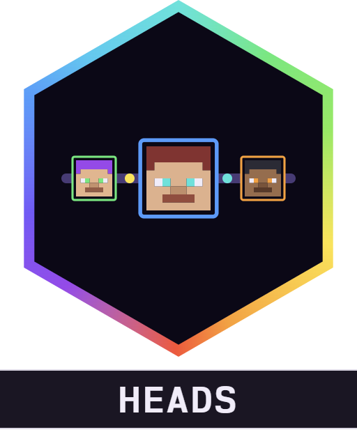

<div align="center">



# Alaydriem's Heads

[](https://github.com/alaydriem/amml-heads/releases)
[](https://github.com/alaydriem/amml-heads/actions/workflows/build.yml)
[](./LICENSE)

[](https://github.com/alaydriem/amml)

</div>

Player heads for Minecraft Bedrock. Each player shows as their skin face (face and hat layer) on the locator bar instead of a coloured dot, and next to their messages in chat.

Client-side only. The faces come from the skins your game already gets from the server. The mod sends nothing.

## Features

- Locator bar: each player's skin face instead of the dot, in any world and on any server
- Chat: the player's face next to their messages
- A skin change shows at once
- The game draws the face on the locator bar itself, so position, fade, sorting and the up and down arrows stay vanilla
- Locator bar waypoints that are not players keep the vanilla icon

## Installation

Install it with the [AMML launcher](https://github.com/alaydriem/amml/releases/latest). The launcher also installs the AMML loader and Alaydriem's Mod Manager, which this mod needs.

## Configuration

Settings are in the mod manager panel and saved to `mods/amml/@alaydriem/heads/config/config.hcl`.

| Setting | Default | Description |
| --- | --- | --- |
| `heads.enabled` | `true` | Show player faces instead of dots |
| `heads.scale` | `1.0` | Face size compared to the dot (1–2, steps of 0.25) |
| `heads.chat` | `true` | Show the face next to chat messages |

## FAQ

**A player still shows a dot.** The face shows when the game has that player's skin. Players not in the player list,
and script or location waypoints, keep the vanilla icon.

**A face looks wrong.** Persona and custom geometry skins whose face is not at the classic place on the skin show
whatever is at that place.

## Building

Requires Windows x64, [mise](https://mise.jdx.dev), rustup and [cargo-nextest](https://nexte.st). No sibling checkout is needed: cargo fetches `amml` and `amml-modmanager` at the release tag named in `Cargo.toml`.

```powershell
mise trust
mise run preflight
mise run package
mise run test
```

`mise run package` writes `dist/@alaydriem/heads` and checks that it holds exactly the dll, `amml.hcl` and the icon. `mise run install --instance <name>` runs `package`, then copies it into `%LOCALAPPDATA%\amml\instances\<name>\mods\amml\@alaydriem\heads\`. Close the game first.

## License

BSD 3-Clause. Copyright (c) 2026 Charles R. Portwood II. See [LICENSE](./LICENSE).
